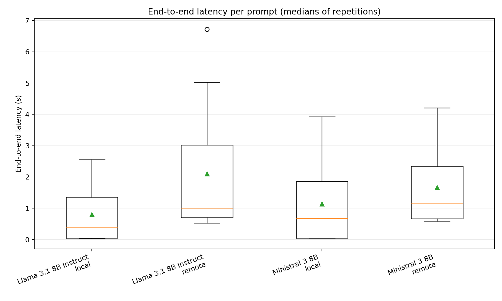
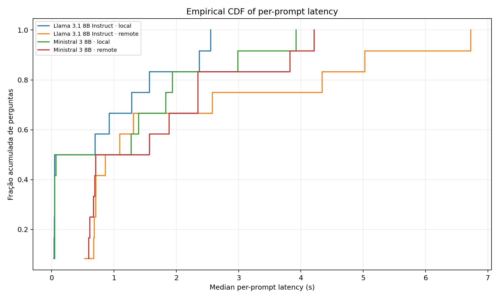

<div align="center">

# 🤖 SLM Latency Benchmark

### Local GPU vs. Cloud Inference for Robotics-Oriented Deployment Decisions

[](https://www.python.org/)
[](https://ollama.com/)
[](https://openrouter.ai/)
[](https://www.nvidia.com/)
[](#-research-scope-and-limitations)

**A reproducible benchmark comparing the latency of ~8B Small Language Models (SLMs) running locally on an NVIDIA GPU through Ollama and remotely through OpenRouter.**

[🎯 Objective](#-research-objective) · [📊 Results](#-experimental-results) · [🚀 Get Started](#-quick-start) · [📈 Figures](#-visualizations) · [🤖 Robotics](#-relevance-to-robotics)

</div>

---

## 🎯 Research Objective

Can **local GPU inference** provide a useful latency advantage over **cloud-hosted inference** for language-enabled robotic systems? And when do the operational trade-offs favor one deployment strategy over the other?

This project studies the inference layer that could support semantic robot functions such as natural-language interaction, task interpretation, and high-level planning. It is motivated by research platforms capable of hosting GPU-accelerated computing, including robots equipped with **NVIDIA Jetson** modules and compatible configurations of **Unitree** humanoid platforms.

> **Scope:** The measurements were collected on a desktop workstation with an **RTX 4070**, **not on a Jetson or a Unitree robot**. They inform architecture selection but do not establish embedded-device performance, power consumption, or real-time control guarantees.

### ⚖️ Two deployment options

| 🖥️ Local inference | ☁️ Remote inference |
|:--|:--|
| SLM runs on a machine's own GPU | SLM is accessed via an external API |
| No per-request API charge for local model inference | Provider pricing and usage limits may apply |
| Requires GPU memory, energy, cooling, and maintenance | Requires connectivity and an available provider |
| Does not require Internet access for inference after setup | Adds network, gateway, and queuing variability |
| May enable privacy-sensitive or disconnected operation | Reduces the need to host model weights locally |

The benchmark **measures latency**. Cost, energy, reliability, and privacy are deployment considerations rather than directly measured outcomes of this dataset.

---

## 🧪 Experimental Setup

| Component | Configuration |
|:--|:--|
| CPU | Intel Core i9-12900K |
| RAM | 64 GB |
| Local accelerator | NVIDIA GeForce RTX 4070, 12 GB VRAM |
| Local inference | Ollama, with GPU-use verification |
| Remote inference | OpenRouter API |
| Local model format | GGUF, Q4_K_M in the recorded experiment |
| Prompt set | 6 multiple-choice questions + 6 text-generation tasks |
| Repetitions | 5 measured repetitions per prompt, model, and environment |
| Warmup | 1 per model and environment |
| Experimental seed | `20261026` |
| Primary metric | Client-observed end-to-end latency (E2E) |
| Secondary metrics | Time to first visible text (TTFC), output tokens, estimated throughput, and answer-key accuracy |

### 🧠 Model catalog

The software supports four model pairs. **Only Llama 3.1 8B Instruct and Ministral 3 8B were included in the recorded 240-request experiment.**

| Model | Ollama identifier | OpenRouter identifier | In published dataset? |
|:--|:--|:--|:--:|
| Llama 3.1 8B Instruct | `llama3.1:8b` | `meta-llama/llama-3.1-8b-instruct` | ✅ |
| Ministral 3 8B | `ministral-3:8b` | `mistralai/ministral-8b-2512` | ✅ |
| Llama 3.1 Nemotron Nano 8B v1 | `Randomblock1/nemotron-nano:8b-instruct-q4_K_M` | `nvidia/llama-3.1-nemotron-nano-8b-v1:free` | — |
| Qwen3 8B | `qwen3:8b` | `qwen/qwen3-8b` | — |

The complete list, including system prompts and provider settings, is maintained in [`models.json`](slm_latency_benchmark/slm_latency_benchmark_v3/models.json). Availability of remote endpoints may change; the runner checks this before running paired tests.

---

## 📊 Experimental Results

The recorded session, [`20261026_132043`](slm_latency_benchmark/slm_latency_benchmark_v3/results/20261026_132043/), contains:

- ✅ **240 successful measured requests** (0 recorded failures).
- 🧠 **2 models × 2 environments × 12 prompts × 5 repetitions**.
- 📏 Matched questions and generation prompts across local and remote configurations.

### Median end-to-end latency (seconds)

| Model | Task category | 🖥️ Local | ☁️ Remote |
|:--|:--|--:|--:|
| Llama 3.1 8B Instruct | Multiple-choice | **0.046** | 0.696 |
| Llama 3.1 8B Instruct | Text generation | **1.427** | 3.462 |
| Ministral 3 8B | Multiple-choice | **0.049** | 0.644 |
| Ministral 3 8B | Text generation | **1.887** | 2.347 |

These are descriptive medians from the supplied experiment, not guaranteed latency bounds. Different completion lengths and provider configurations can influence comparisons. Answer accuracy is a secondary diagnostic and should not be interpreted as a general model-quality ranking.

**Data:** [`raw_results.csv`](slm_latency_benchmark/slm_latency_benchmark_v3/results/20261026_132043/raw_results.csv) · **Summary:** [`summary.csv`](slm_latency_benchmark/slm_latency_benchmark_v3/results/20261026_132043/figures/summary.csv) · **Analysis:** [`report.md`](slm_latency_benchmark/slm_latency_benchmark_v3/results/20261026_132043/figures/report.md)

## 📈 Visualizations

The analysis script generates latency distributions, TTFC comparisons, throughput plots, accuracy diagnostics, empirical CDFs, and matched-prompt comparisons.

<div align="center">

**End-to-end latency distributions**



**Empirical latency distributions (CDF)**



</div>

Additional plots and their underlying tables are in [`results/20261026_132043/figures/`](slm_latency_benchmark/slm_latency_benchmark_v3/results/20261026_132043/figures/).

---

## 🚀 Quick Start

### 1. Clone and enter the project

```bash
git clone https://github.com/vitor-souza-ime/SLM_latency_benchmark.git
cd SLM_latency_benchmark/slm_latency_benchmark/slm_latency_benchmark_v3
```

### 2. Install Python dependencies

Requires **Python 3.10+**, a running Ollama installation, and an NVIDIA GPU for GPU-local measurements.

```bash
python -m venv .venv

# Linux/macOS
source .venv/bin/activate

# Windows PowerShell
# .venv\Scripts\Activate.ps1

python -m pip install -r requirements.txt
```

Install Ollama from [ollama.com](https://ollama.com/), ensure the server is running, and pull the **two models evaluated in the recorded experiment**:

```bash
ollama pull llama3.1:8b
ollama pull ministral-3:8b
```

> 💡 Other supported models are listed in `models.json` and can be downloaded separately. Model identifiers and remote availability may change.

### 3. Configure remote API access

Create an API key at [OpenRouter](https://openrouter.ai/) and set it as an environment variable. **Never commit keys to GitHub.**

```bash
# Linux/macOS
export OPENROUTER_API_KEY="YOUR_API_KEY"

# Windows PowerShell
# $env:OPENROUTER_API_KEY = "YOUR_API_KEY"
```

### 4. Validate before spending API credits

```bash
# Offline protocol preview: no inference
python benchmark/run.py --model-ids 1,3 --repeats 5 --max-remote-requests 122 --dry-run

# Read-only availability check: no generation requests
python benchmark/check_catalog.py
```

### 5. Run the benchmark

To reproduce the **protocol settings** of the recorded two-model session:

```bash
python benchmark/run.py \
  --model-ids 1,3 \
  --repeats 5 \
  --warmups 1 \
  --seed 20261026 \
  --max-remote-requests 122 \
  --skip-unavailable
```

> ⚠️ **This command can incur OpenRouter charges.** It does not guarantee the same outcomes: provider routing, network conditions, model builds, and service load can change. The `--skip-unavailable` flag excludes an unavailable model from **both** environments to preserve a matched design.

For a GPU-only test without the remote API:

```bash
python benchmark/run.py --local-only --model-ids 1,3
```

The runner randomizes execution order, performs warmups, verifies GPU residency through Ollama, measures streamed responses, and stores raw results plus experiment metadata. CPU-only inference is **not** a benchmark condition.

### 6. Analyze results and recreate plots

```bash
python benchmark/analyze.py \
  --input results/20261026_132043/raw_results.csv
```

For a new run, replace `20261026_132043` with the automatically generated experiment directory under `results/`.

Optional provider metadata enrichment:

```bash
python benchmark/enrich_providers.py \
  --input results/20261026_132043/raw_results.csv
```

### 7. Launch the optional dashboard

```bash
python -m pip install -r requirements-ui.txt
streamlit run app.py
```

### 8. Run tests

```bash
python -m unittest discover -s tests -v
```

Tests use mocked responses to validate protocol and parsing logic; they are **not** substitute performance measurements.

---

## 🗂️ Repository Layout

```text
SLM_latency_benchmark/
├── README.md                      # This overview (place at repository root)
└── slm_latency_benchmark/
    └── slm_latency_benchmark_v3/
        ├── app.py                 # Optional Streamlit interface
        ├── models.json            # Local/remote model mapping
        ├── requirements.txt
        ├── requirements-ui.txt
        ├── benchmark/
        │   ├── run.py             # Benchmark orchestration and measurements
        │   ├── analyze.py         # Statistics and plots
        │   ├── check_catalog.py   # Remote endpoint preflight
        │   └── enrich_providers.py
        ├── data/                  # Question and generation prompt datasets
        ├── results/               # Experiment configurations, CSVs and figures
        └── tests/                 # Automated tests
```

## 📐 Measurement Definitions

- **E2E latency:** elapsed client time from request initiation to completion of the streamed answer.
- **TTFC:** elapsed time until the first **visible** text arrives; this is not necessarily the provider's first internal decoder token.
- **Output throughput:** approximate visible output-token rate after TTFC, subject to streaming/token-count limitations.
- **Matched comparison:** local and remote results are analyzed for the same prompt and model, using per-prompt summaries.
- **Accuracy diagnostic:** strict answer-key checking for multiple-choice questions; not a comprehensive semantic evaluation.

Remote E2E latency includes connection, routing, possible provider queueing, generation, and response transfer. The local measurements include client-side overhead. The project does not isolate GPU kernel execution time.

## 🤖 Relevance to Robotics

The results can inform the design of **high-level language-processing components** in robotic systems, such as:

- 🗣️ Natural-language command understanding and human–robot interaction.
- 🧭 Semantic task decomposition and high-level planning.
- 🛜 Local/cloud architectural decisions for robots with intermittent connectivity.
- 🔋 Trade-off studies involving compute capacity, memory, network dependence, and operating costs.

**Important:** The prompt set is general-purpose, not a robotics task suite. No navigation, manipulation, embedded Jetson inference, battery drain, or real-robot safety test was performed. Robot control and other hard real-time functions require separate validation and should not depend solely on unverified language-model outputs.

## ⚠️ Research Scope and Limitations

1. **Desktop-to-embedded transfer:** RTX 4070 measurements cannot be directly extrapolated to Jetson performance or power consumption.
2. **Model equivalence:** Local GGUF quantization and remote provider settings may differ even when model families match.
3. **Cloud provider routing:** The recorded session did not pin remote providers, introducing infrastructure variability.
4. **Limited task diversity:** Six question prompts and six generation prompts per model provide an exploratory latency study, not a universal benchmark.
5. **Network context:** A consumer Internet speed test is not a direct measurement of round-trip time to OpenRouter.
6. **Costs:** API pricing and locally hosted hardware/energy costs require separate measurement or explicitly stated assumptions.

For stronger robotics-focused evidence, future studies should include Jetson-based measurements, robotics-specific prompts, simultaneous perception workloads, network impairment experiments, and energy profiling.

## 📚 Documentation and Resources

- [Ollama documentation](https://docs.ollama.com/)
- [OpenRouter documentation](https://openrouter.ai/docs)
- [OpenRouter models and pricing](https://openrouter.ai/models)
- [NVIDIA Jetson developer resources](https://developer.nvidia.com/embedded/jetson)
- [Unitree Robotics](https://www.unitree.com/)

## 👤 Maintainer and Citation

Maintained by [@vitor-souza-ime](https://github.com/vitor-souza-ime).

If you use the benchmark code or dataset in academic work, please link to this repository and cite the associated scientific article once its bibliographic details and DOI are available. **No publication DOI is claimed here.**

---

<div align="center">

🤖 **Measure locally. Compare fairly. Deploy responsibly.** ☁️

[⬆ Back to top](#-slm-latency-benchmark)

</div>
